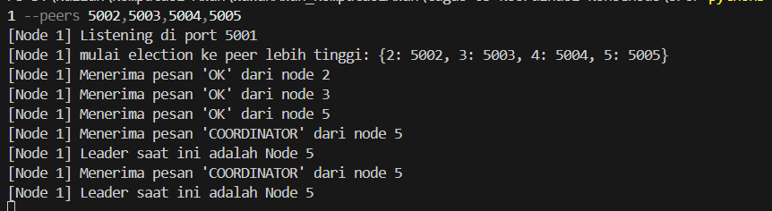
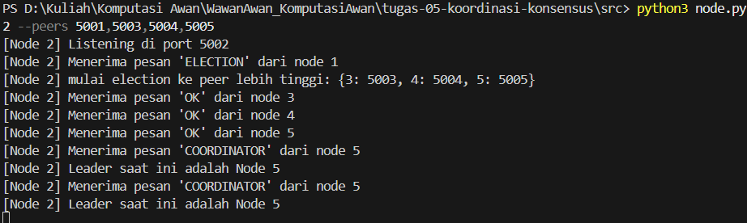
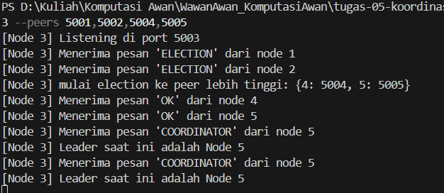
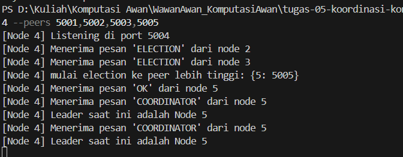
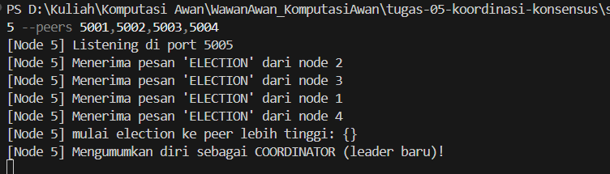
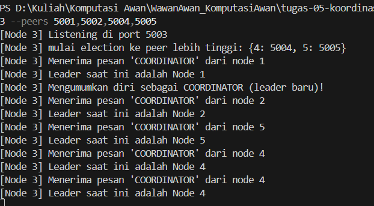

# Jurnal Proses — Tugas 5

## Implementasi Bully
- Tidak ada kendala saat mengerjakan Todo 1-4, tapi karena tidak ada baris code untuk waktu, jadi harus balik ke node.py untuk nulis dan ngestart ulang terminalnya.

## Skenario 1: Start normal
- Leader yang terpilih: Node 5
- Log/observasi: 
### 1. Log terminal

A. T1

B. T2

C. T3

D. T4

E. T5 (Leader)

## Skenario 2: Leader dimatikan
- Leader baru yang terpilih: Node 4

- Berapa lama waktu sampai leader baru terdeteksi: 4031.0645 ms atau 4 detik

## Observasi code dan logika bully

A. Mengapa Bully memilih id besar

Alasan mengapa bully algorithm selalu memilih node paling besar untuk dijadikan sebagai leader adalah karena ia percaya jika nomor id yang besar melambangkan otoritas tertinggi kayak pangkat. Selain itu, nama bully algorithm sendiri sebenernya lebih dikenal sebagai Top leader election Algorithm, jadi wajar kalau dia bakal selalu milih node paling besar. Tapi id yang besar belum tentu lebih kuat atau lebih cepat dari node id kecil, kalau kayak gitu maka dia perlu proses seleksi yang beda.

B. Kelemahan algoritma Bully

Kelemahan dari algoritma ini ada di waktu. Kalau semisal node 5 tadi mati, node 4 harus menunggu 2 detik untuk memastikan node 5 mati. Padahal belum tentu node 5 mati, bisa aja dia lagi maintenance atau jaringan lagi gangguan. Hal tersebut menyebabkan terjadi waktu tunggu yang lama untuk memilih leader baru. Simpelnya, sistem pesan pada algoritma ini yang cukup menguras waktu dan energi node, apalagi kalau jumlah nodenya banyak.

C. Algoritma yang cocok untuk foodgo

Kalau menurut kami, algoritma yang cocok untuk mengganti algoritma di foodgo adalah **Raft**, karena sistem Raft lebih modern dan efisien daripada Bully Algorithm, apalagi kalau jumlah nodenya banyak. Raft sendiri mengandalkan sistem voting agar leader bisa terpilih. Selain itu, selama mayoritas node masih aktif, kegagalan satu node gak bakal mempengaruhi pengiriman pesan antar node lain karena mereka tetep bisa bertukar pesan tanpa harus menunggu leader. Beda sama bully yang ketika ada satu node besar mati, node lain harus menunggu 2 detik untuk memastikan node besar beneran mati lalu melakukan election. 2 detik itu waktu dari laptop, bisa aja waktu atau latency di implementasi asli jauh lebih lama.

## Log Penggunaan AI (Level 2)

> Wajib diisi sesuai kebijakan Level 2 di [`../RUBRIK-UMUM.md`](../RUBRIK-UMUM.md). Tulis "Tidak memakai AI" pada baris pertama jika memang tidak dipakai. Hanya untuk brainstorming ide/outline — bukan untuk kode/analisis/teks akhir.

| Tanggal | Tool AI | Prompt yang diberikan | Ringkasan saran/ide AI | Bagaimana diolah jadi tulisan/kode sendiri |
|---|---|---|---|---|
| ... | ... | ... | ... | ... |
