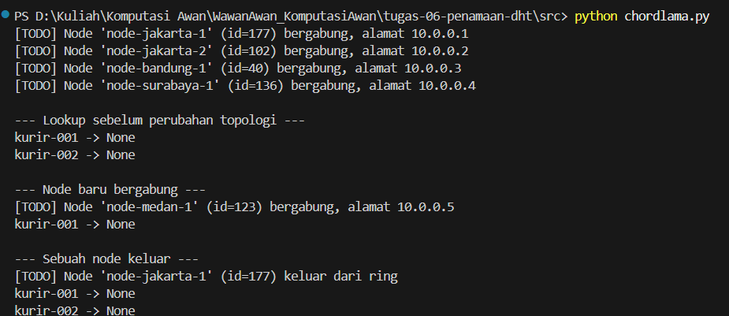
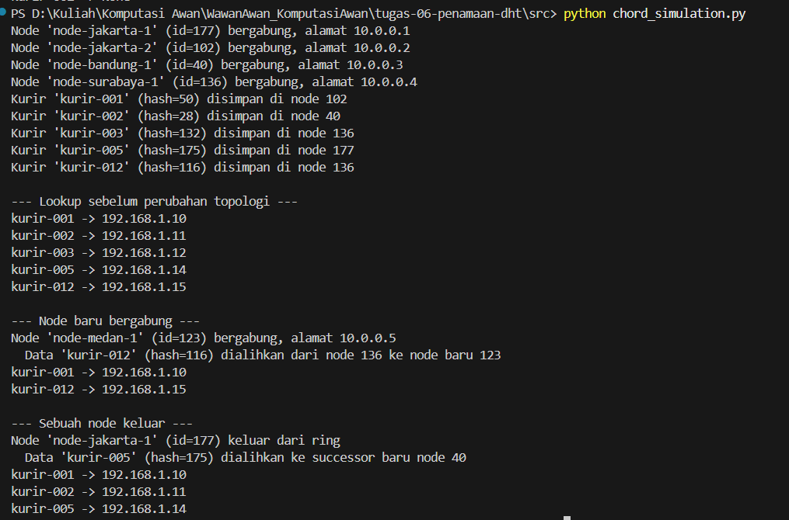

# Jurnal Proses — Tugas 6

## Implementasi find_successor
- Kesalahan pertama yang ditemui (mis. lupa wrap-around di ring): 
  Pas awal nyoba bikin logika successor, kami mikir kalau pencarian linear biasa pake perulangan `node_id >= key_hash`. Masalahnya muncul pas ada hash kurir yang nilainya ternyata lebih besar dari seluruh ID node yang lagi aktif di ring. Contohnya kasus `kurir-005` yang punya hash 175, pas node jakarta-1 (id=177) keluar, node paling besar di ring tinggal node surabaya (id=136). Karena gak ada ID node yang lebih besar dari 175, perulangannya selesai gitu aja tanpa nemu node tujuan, ujung-ujungnya fungsi malah ngembaliin `None`. Selain itu di kode template awal (`chordlama.py`), fungsinya juga masih berupa `pass` sehingga semua lookup kurir sempat gagal/None semua.

  

- Cara memperbaikinya: 
  Kami menambahkan sebuah logika yang menerapkan sifat melingkar (wrap-around) sesuai konsep Chord ring. Jadi setelah daftar ID node diurutin (`sorted_nodes`), kita cari node pertama yang `>= key_hash`. Tapi kalau perulangannya tembus sampai akhir dan tetep gak nemu node yang lebih besar, kita gak balikin `None`, melainkan kita puter balik ke awal ring dengan ngembaliin node paling pertama yaitu `sorted_nodes[0]`. 
  
  Dengan perbaikan ini, hash yang ngelewatin ujung ring (kayak kurir-005 hash 175) otomatis muter balik dan ditampung sama node paling kecil yaitu node bandung (id=40). Pas di-run ulang, semua lookup kurir langsung sukses dapet IP aslinya secara akurat:

  

## Skenario join/leave
- Hasil sebelum & sesudah node baru bergabung:
  

Sebelum digabung. Ring baru berisi empat node, berurutan melingkar: node-bandung-1 (ID 40), node-jakarta-2 (102), node-surabaya-1 (136), dan node-jakarta-1   (177). Data kurir-012 punya hash 116, sehingga dipegang oleh node pertama yang ID-nya sama dengan atau lebih besar dari 116, yaitu node-surabaya-1 (136). Pada kondisi ini, lookup("kurir-012") mengembalikan IP 192.168.1.15.

Sesudah mereka gabung. node-medan-1 (ID 123, IP 10.0.0.5) masuk ke ring di antara node 102 dan 136, sehingga urutannya menjadi 40 → 102 → 123 → 136 → 177. Node 123 sekarang menjadi node terdekat yang ID-nya masih ≥ 116, jadi tanggung jawab atas kurir-012 bakal pindah dari node 136 ke node 123. Saat lookup("kurir-001") dan lookup("kurir-012") si eksekusi lagi, keduanya tetap mengembalikan IP yang benar, jadi gaka da data yang miss.

- Hasil sebelum & sesudah node keluar:
  

Sebelum keluar. Ring berisi lima node dengan urutan 40 → 102 → 123 → 136 → 177. Data kurir-005 (hash 175) dipegang node jakarta-1 (177) dan alamat IP-nya 192.168.1.14.

Sesudah keluar. Node 177 dihapus, sehingga sisa ring menjadi 40 → 102 → 123 → 136. Sekarang tidak ada lagi node dengan ID ≥ 175, jadi pencarian kembali ke awal ring (wrap-around) dan kurir-005 pindah ke node bandung-1 (40). Hasil lookup setelah node keluar menunjukkan kurir-001, kurir-002, dan kurir-005 masih bisa diakses dengan IP yang tepat.

## Log Penggunaan AI (Level 2)

> Wajib diisi sesuai kebijakan Level 2 di [`../RUBRIK-UMUM.md`](../RUBRIK-UMUM.md). Tulis "Tidak memakai AI" pada baris pertama jika memang tidak dipakai. Hanya untuk brainstorming ide/outline — bukan untuk kode/analisis/teks akhir.

| Tanggal | Tool AI | Prompt yang diberikan | Ringkasan saran/ide AI | Bagaimana diolah jadi tulisan/kode sendiri |
|---|---|---|---|---|
| ... | ... | ... | ... | ... |
