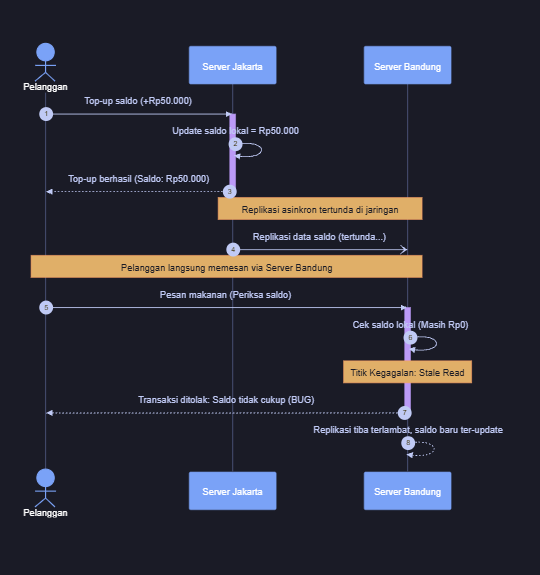
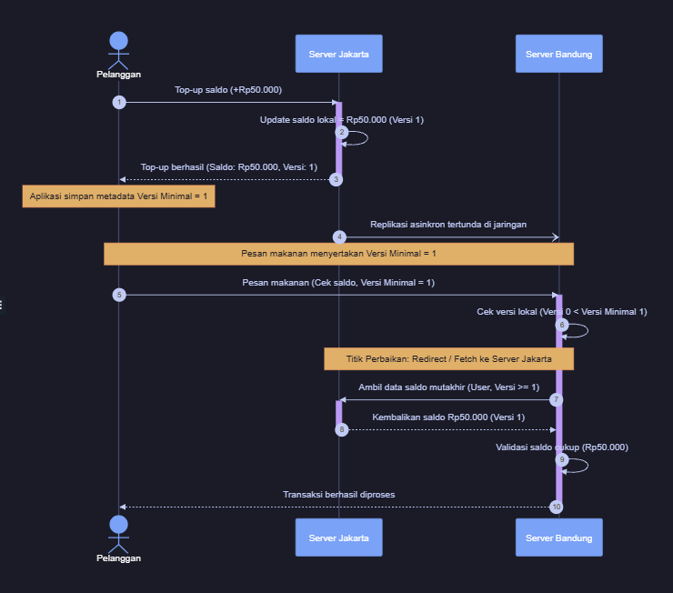

# Jurnal Proses — Tugas 7

## Diskusi pemilihan model konsistensi
- **Argumen yang dipertimbangkan**: Penerapan *Eventual Consistency* murni (kondisi di mana data dibiarkan berbeda sementara dan baru konsisten seiring berjalannya waktu) kami nilai sangat berisiko untuk data finansial. Jeda waktu replikasi antar-server regional (Jakarta–Bandung) memicu anomali *stale read* (pembacaan data lama yang belum ter-update), yang mengakibatkan pesanan makanan ditolak karena saldo terbaca Rp0. Kondisi ini juga membuka celah *double-spending*, yaitu risiko pengguna dapat membelanjakan nominal saldo yang sama lebih dari satu kali di server berbeda sebelum sistem sempat memotongnya. *Sequential Consistency* secara teoretis dapat menjadi solusi karena menjamin seluruh server menyepakati satu urutan eksekusi yang seragam secara global (*total order*), sehingga operasi *top-up* di Jakarta dipastikan selesai dan tercatat sebelum server Bandung membaca saldo tersebut. Namun, berdasarkan Teorema CAP/PACELC, model ini membawa *trade-off* yang berat: terjadi lonjakan waktu tunggu respons (*latency penalty*) karena setiap transaksi harus menunggu konfirmasi sinkron antar-kota, serta risiko penurunan ketersediaan layanan (*availability drop*) di mana aplikasi terpaksa menolak melayani transaksi jika koneksi komunikasi antar-wilayah terputus (*network partition*).

- **Contoh skenario**: Semisal ada buku kas catatan saldo bersama di mana satu buku dipegang cabang Jakarta dan satu buku di cabang Bandung. Pelanggan baru saja menyetor uang Rp50.000 di Jakarta, lalu kasir Jakarta mengirim surat pos ke Bandung untuk memperbarui catatan di sana. Beberapa saat kemudian, sebelum surat pos tiba (mencerminkan jeda replikasi), pelanggan mendatangi cabang Bandung untuk membeli makanan. Kasir Bandung menolak transaksi karena buku catatannya masih mencatat saldo Rp0, inilah gambaran *stale read*. Jika pada saat bersamaan saldo Rp50.000 tersebut sempat dibelanjakan di kedua cabang sebelum surat tiba, perusahaan merugi karena uangnya terpakai dua kali (*double-spending*). Kalau semisal kita maksa pakai *Sequential Consistency*, kasir Jakarta wajib menelepon dan menunggu kasir Bandung selesai mencatat di bukunya sebelum setoran pelanggan dinyatakan sukses. Cara ini memang mencegah kesalahan saldo, tetapi membuat pelanggan mengantre sangat lama (*latency penalty*) dan tidak bisa bertransaksi sama sekali jika sambungan telepon antar-kota sedang putus (*availability drop* akibat *network partition*).

- **Kesimpulan akhir & alasan**:
Kami menyimpulkan solusi yang tepat adalah mengombinasikan dua model: mempertahankan Eventual Consistency (replikasi asinkron) di tingkat server backend agar sistem tetap cepat dan berkapasitas tinggi, lalu melapisinya dengan jaminan Client-Centric Consistency (khususnya *Read-Your-Writes*) di tingkat aplikasi pengguna. Alasannya, Eventual Consistency murni tidak cukup karena bisa menggagalkan transaksi akibat saldo terbaca Rp0, sedangkan Sequential Consistency murni terlalu membebani sistem dengan latensi tinggi. Melalui kombinasi ini, aplikasi pengguna melacak nomor versi mutasi terakhirnya sehingga saldo terbarunya selalu terbaca akurat, tanpa harus memaksa seluruh server antar-kota sinkron secara kaku.

- **Sequence diagram**

    Fungsi: Visualisasi alur pertukaran pesan (operasi baca/tulis dan replikasi) antar-server secara kronologis untuk memperlihatkan dengan jelas titik kegagalan (*stale read*) saat replikasi tertunda, serta titik perbaikan ketika mekanisme *Read-Your-Writes* diterapkan melalui pengecekan nomor versi mutasi.

    Sequence :

    1. Skenario Tanpa Jaminan Konsistensi (Bug Terjadi):
    ```mermaid
    sequenceDiagram
        autonumber
        actor Pelanggan
        participant Jakarta as Server Jakarta
        participant Bandung as Server Bandung

        Pelanggan->>Jakarta: Top-up saldo (+Rp50.000)
        activate Jakarta
        Jakarta->>Jakarta: Update saldo lokal = Rp50.000
        Jakarta-->>Pelanggan: Top-up berhasil (Saldo: Rp50.000)
        deactivate Jakarta

        Note over Jakarta,Bandung: Replikasi asinkron tertunda di jaringan
        Jakarta-)Bandung: Replikasi data saldo (tertunda...)

        Note over Pelanggan,Bandung: Pelanggan langsung memesan via Server Bandung
        Pelanggan->>Bandung: Pesan makanan (Periksa saldo)
        activate Bandung
        Bandung->>Bandung: Cek saldo lokal (Masih Rp0)
        Note over Bandung: Titik Kegagalan: Stale Read
        Bandung-->>Pelanggan: Transaksi ditolak: Saldo tidak cukup (BUG)
        deactivate Bandung

        Bandung-->>Bandung: Replikasi tiba terlambat, saldo baru ter-update
    ```
    

    2. Skenario dengan Solusi Read-Your-Writes (Bug Teratasi):
    ```mermaid
    sequenceDiagram
        autonumber
        actor Pelanggan
        participant Jakarta as Server Jakarta
        participant Bandung as Server Bandung

        Pelanggan->>Jakarta: Top-up saldo (+Rp50.000)
        activate Jakarta
        Jakarta->>Jakarta: Update saldo lokal = Rp50.000 (Versi 1)
        Jakarta-->>Pelanggan: Top-up berhasil (Saldo: Rp50.000, Versi: 1)
        deactivate Jakarta

        Note over Pelanggan: Aplikasi simpan metadata Versi Minimal = 1
        Jakarta-)Bandung: Replikasi asinkron tertunda di jaringan

        Note over Pelanggan,Bandung: Pesan makanan menyertakan Versi Minimal = 1
        Pelanggan->>Bandung: Pesan makanan (Cek saldo, Versi Minimal = 1)
        activate Bandung
        Bandung->>Bandung: Cek versi lokal (Versi 0 < Versi Minimal 1)

        Note over Bandung,Jakarta: Titik Perbaikan: Redirect / Fetch ke Server Jakarta
        Bandung->>Jakarta: Ambil data saldo mutakhir (User, Versi >= 1)
        activate Jakarta
        Jakarta-->>Bandung: Kembalikan saldo Rp50.000 (Versi 1)
        deactivate Jakarta

        Bandung->>Bandung: Validasi saldo cukup (Rp50.000)
        Bandung-->>Pelanggan: Transaksi berhasil diproses
        deactivate Bandung
    ```
    
## Simulasi (jika dikerjakan)
- Hasil skenario naif vs Read-Your-Writes: ...

## Log Penggunaan AI (Level 2)

> Wajib diisi sesuai kebijakan Level 2 di [`../RUBRIK-UMUM.md`](../RUBRIK-UMUM.md). Tulis "Tidak memakai AI" pada baris pertama jika memang tidak dipakai. Hanya untuk brainstorming ide/outline — bukan untuk kode/analisis/teks akhir.

| Tanggal | Tool AI | Prompt yang diberikan | Ringkasan saran/ide AI | Bagaimana diolah jadi tulisan/kode sendiri |
|---|---|---|---|---|
| ... | ... | ... | ... | ... |
