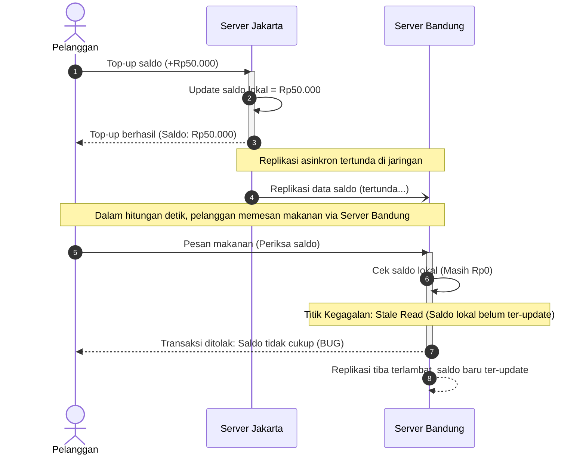
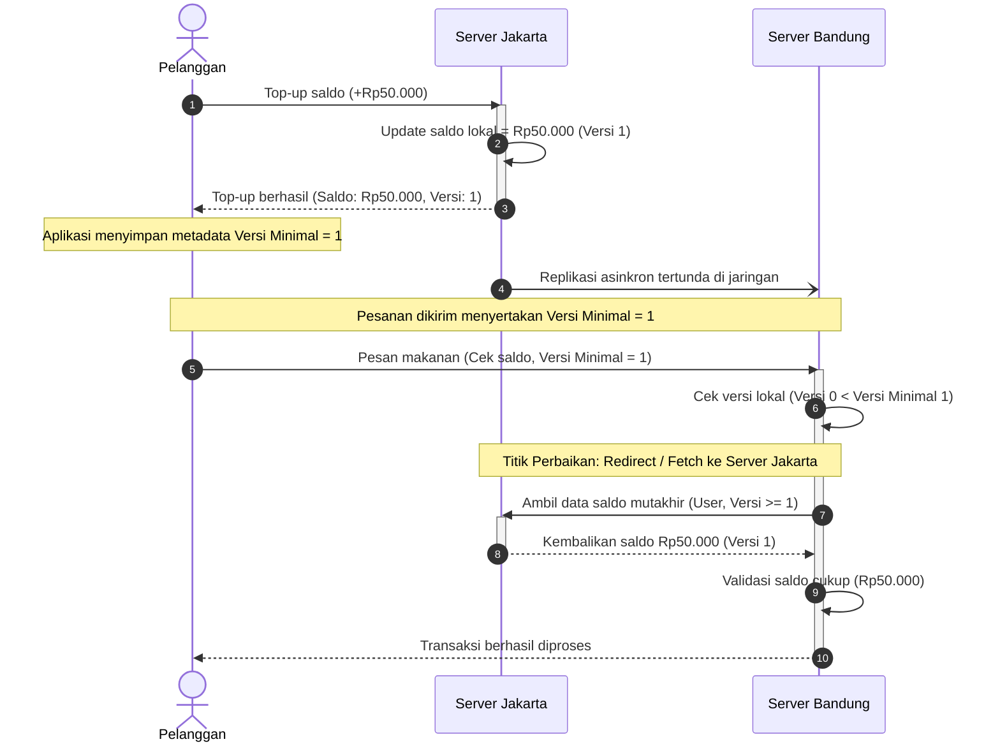

# Tugas 7 (Pekan 7) — Konsistensi Data

**Materi terkait:** Data-Centric Consistency (Sequential, Eventual), Client-Centric Consistency.

## Studi Kasus

Data saldo *e-wallet* pelanggan FoodGo berbeda antara server wilayah **Jakarta** dan **Bandung** karena replikasi antar server berjalan lambat. Contoh kasus nyata: pelanggan top-up saldo lewat server Jakarta, lalu dalam hitungan detik memesan makanan lewat aplikasi yang tersambung ke server Bandung — saldo belum ter-update, transaksi ditolak padahal saldo sebenarnya cukup.

## Tugas Kelompok

### Bagian 1 — Analisis (wajib)

1. Tentukan: apakah kasus ini **membutuhkan Sequential Consistency** (semua replika melihat urutan operasi yang sama) atau **cukup Eventual Consistency** (replika akan konsisten "pada akhirnya", boleh sementara berbeda)? Berikan argumen berbasis dampak bisnis (mis. kasus saldo *e-wallet* jauh lebih sensitif dibanding kasus "jumlah like" di media sosial).
2. Jika kalian menyimpulkan Eventual Consistency saja **tidak cukup** untuk skenario ini, usulkan pendekatan **Client-Centric Consistency** yang relevan (mis. *Read-Your-Writes*: pelanggan yang baru top-up harus selalu melihat saldo terbarunya sendiri, walau replika lain belum sinkron).
3. Gambarkan **diagram alir urutan (sequence diagram)** yang menunjukkan operasi read/write antara pelanggan, server Jakarta, server Bandung, dan proses replikasi — untuk skenario **tanpa** jaminan konsistensi (bug terjadi) DAN skenario **dengan** solusi yang kalian usulkan (bug teratasi). Pakai Mermaid (`sequenceDiagram`) di `README.md` — lihat contoh cara pakai di Tugas 2.

### Bagian 2 — Simulasi (opsional, nilai tambah)

Skeleton `src/replica_simulation.py` mensimulasikan dua replika (Jakarta & Bandung) dengan delay replikasi buatan. Lengkapi TODO untuk:
1. Menunjukkan kondisi **inconsistent read** (replika Bandung masih menunjukkan saldo lama walau Jakarta sudah update).
2. Mengimplementasikan mekanisme **Read-Your-Writes** sederhana (mis. dengan version/timestamp per client) yang memperbaiki masalah tersebut.

```bash
python3 src/replica_simulation.py
```

## Struktur Submission

```
tugas-07-konsistensi-data/
├── README.md      # Analisis konsistensi + sequence diagram Mermaid
├── JURNAL.md
├── src/            # (opsional) simulasi replikasi
└── bukti/          # (jika mengerjakan simulasi) output program
```

## Rubrik Penilaian (Tugas 7)

| Komponen | Bobot | Kriteria |
|---|---|---|
| Ketepatan pemilihan model konsistensi | 30% | Argumen berbasis dampak bisnis nyata, bukan hafalan definisi |
| Kualitas sequence diagram | 30% | Menunjukkan jelas titik kegagalan & titik perbaikan |
| Usulan solusi client-centric | 25% | Solusi konkret dan dapat diimplementasikan (bukan wacana abstrak) |
| Proses & kontribusi kelompok | 15% | `JURNAL.md`, commit history (+ bonus jika simulasi dikerjakan) |

## Batasan Penggunaan AI (Level 2)

Kebijakan **Level 2 (AI Assisted Idea Generation & Structuring)** berlaku — lihat [`../RUBRIK-UMUM.md`](../RUBRIK-UMUM.md). Boleh bertanya konsep umum consistency model ke AI untuk brainstorming; **tidak boleh** meminta AI menuliskan analisis akhir/sequence diagram atau isi `# TODO` di `src/replica_simulation.py` yang tinggal ditempel. Catat pemakaian AI di "Log Penggunaan AI" pada `JURNAL.md`.

- Sebagai bukti pemahaman konsep (bukan hafalan jawaban skenario FoodGo saja), `README.md` wajib menyertakan **satu skenario tambahan** yang kalian buat sendiri (mis. kasus lain di aplikasi ojek online) dan menentukan model konsistensi yang tepat untuk skenario tambahan tersebut.

---

## Sequence Diagram Konsistensi Data (FoodGo)

### 1. Skenario Tanpa Jaminan Konsistensi (Bug Inconsistent Read Terjadi)

Diagram di bawah mengilustrasikan kondisi *bug* ketika pelanggan melakukan top-up di Server Jakarta, tetapi pesanan makanan ditolak oleh Server Bandung akibat keterlambatan replikasi asinkron (*stale read*).



**Titik Kegagalan:**  
Server Bandung memproses permintaan verifikasi saldo hanya berdasarkan data lokalnya yang masih usang (Rp0), karena pesan pembaruan saldo dari Server Jakarta masih tertahan dalam proses replikasi jaringan asinkron.

---

### 2. Skenario dengan Solusi Read-Your-Writes (Bug Teratasi)

Diagram di bawah mengilustrasikan solusi *Client-Centric Consistency (Read-Your-Writes)*. Aplikasi klien mencatat versi mutasi terakhir (`versi_minimal = 1`), sehingga Server Bandung yang datanya tertinggal akan mengalihkan (*redirect*) atau mengambil data mutakhir dari Server Jakarta sebelum mengeksekusi transaksi.



**Titik Perbaikan:**  
Aplikasi klien menyertakan nomor versi data terakhir yang pernah ditulisnya. Server Bandung mendeteksi bahwa versinya lokal masih tertinggal (`Versi 0 < Versi 1`), sehingga Server Bandung secara proaktif mengambil data terkini langsung dari Server Jakarta sebelum menentukan kelayakan transaksi. Saldo terbaca valid dan pesanan berhasil diproses.
